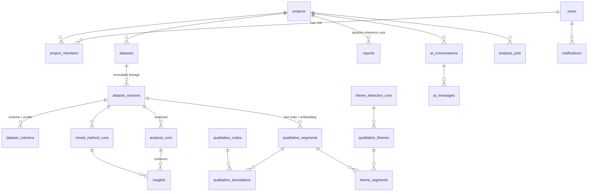

# Data model (PostgreSQL 16 + pgvector)

All primary keys are random UUIDs (non-enumerable ids). Timestamps are `timestamptz`. JSON documents are `jsonb`. Everything hangs off `projects` with `ON DELETE CASCADE`, so deleting a project removes its data; files are removed by the service layer.

## Tables

| Table | Purpose | Notable constraints / indexes |
|---|---|---|
| `users` | accounts (Argon2id hash) | unique index on `lower(email)` |
| `refresh_tokens` | rotating, single-use refresh tokens (SHA-256 of the token only) | unique `token_hash`; `revoked_at` powers reuse detection |
| `projects` | research context = permission boundary | `revision` counter busts dashboard cache |
| `project_members` | `OWNER`/`EDITOR`/`VIEWER` | PK `(project_id, user_id)`, role CHECK |
| `datasets` | an uploaded source file | `status` CHECK (`PROCESSING/READY/FAILED`); raw file path + SHA-256 |
| `dataset_versions` | **immutable** typed snapshot (Parquet on disk) | unique `(dataset_id, version_number)`; `parent_version_id`, `transformation` (ops + log + `ops_hash`), `content_hash`, `quality` |
| `dataset_columns` | per-version schema + computed profile | unique `(version_id, name)`; `semantic_type`, `missing_pct`, `profile` jsonb |
| `analysis_runs` | one computed analysis | **partial unique index** `(dataset_version_id, analysis_type, config_hash) WHERE status IN (PENDING, RUNNING, COMPLETED)` → idempotent runs; failed runs may be retried; `provenance` (library versions, seed, config); `interpretation` kept apart from `result` |
| `insights` | rule-derived statements with `evidence` | unique `(project_id, dedupe_key)`; `narrative` (AI/rule text) separate from `statement` |
| `saved_visualizations` | chart request + computed `ChartSpec` | |
| `qualitative_segments` | response (or sentence group) with `embedding vector` | unique `(dataset_version_id, column_name, row_index, seg_index)` → idempotent segmentation; `row_index` is the join key to quantitative columns |
| `qualitative_codes` / `qualitative_annotations` | codebook and its (accepted/suggested/rejected) applications | unique `(project_id, name)`, unique `(segment_id, code_id)`; CHECKs on `status`, `source` |
| `theme_detection_runs` / `qualitative_themes` / `theme_segments` | reproducible theme sets and memberships | unique `(dataset_version_id, column_name, params_hash)`; membership has `score`, `source` (auto/manual) |
| `mixed_method_runs` | integrated result (joint display) | unique `(dataset_version_id, config_hash)` |
| `reports` | ordered `sections` referencing runs/insights/etc. + `sources` index | references validated to belong to the same project |
| `ai_conversations` / `ai_messages` | assistant history; `blocks` (typed provenance), `evidence`, `meta` (provider, model, prompt version, validation) | conversations private to their author |
| `analysis_jobs` | async work | status CHECK; `stage`, `completed_stages/total_stages` (real progress); partial unique `(project_id, idempotency_key) WHERE active` |
| `notifications` | per-user job outcomes | index `(user_id, created_at)` |

## Integrity rules enforced in code

* Raw upload bytes are never modified; every transformation produces a new version with `parent_version_id` and the operations that produced it.
* A run, report section, visualization or conversation can only reference a dataset version **in the same project** (`access.version_in_project`, `reports.validate_sections`).
* Multi-step writes happen in one transaction; file writes are compensated (parquet removed if the DB write fails).
* Embeddings are stored in an unconstrained `vector` column with the producing model id beside it (`embedding_model`), so vectors from different models are never compared.

## Indexing decisions

* Every foreign key used for listing is indexed; project-scoped listings use `(project_id, created_at)`.
* No ANN index (HNSW/IVFFlat) on `embedding`: searches are always filtered to one `(dataset_version_id, column_name)` slice — the unique index narrows to that slice and the exact scan over a few thousand to tens of thousands of rows is accurate and fast (`EXPLAIN ANALYZE` in `docs/performance.md`). Add HNSW only if a single text column exceeds ~10⁵ segments.
